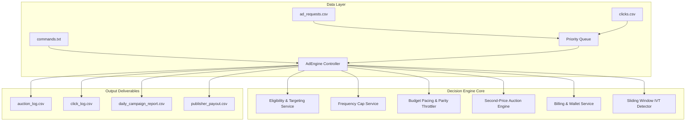

# Digital Ad Auction, Budget Pacing and Frequency-Cap Engine (PS-091)
### Placement Coaching Capstone Project — 10 SECONDS
**Team ID**: T049 | **Domain**: Media - AdTech | **Tech Stack**: Python 3.12+ (Zero Runtime External Dependencies)

### Team Members & Responsibilities:
- **Yashwanth S** ([@yashwanth06s](https://github.com/yashwanth06s)) — Decision Engine Core, Second-Price Auction, Budget Pacing & Billing Architecture
- **Yashaswini** ([@yashaswini3135](https://github.com/yashaswini3135)) — Frequency Capping, Invalid Traffic (IVT) Detection, Publisher Settlements & Automated Test Suite

### 5-Minute Demo Video Walkthrough:
- **Demo Video Link**: [Watch 5-Minute Capstone Demo Video](https://drive.google.com/file/d/1ZCwVPkkgrb6bdHcBE2F3A2F3103d_n_u/view?usp=sharing) *(Public Google Drive )*
- **Demo Video Script & Timing Guide**: [`docs/DEMO_VIDEO_SCRIPT.md`](docs/DEMO_VIDEO_SCRIPT.md)

---

## 1. Project Overview

In programmatic digital advertising, ad exchanges must process continuous streams of ad requests and click interactions within milliseconds while upholding advertiser budgets, publisher floor prices, user fatigue constraints, and fraud detection policies.

This project implements a command-driven **Ad-Serving Decision Engine** developed for Problem Statement **PS-091**. The engine:
1. **Normalizes Heterogeneous Bids**: Unifies CPM and CPC pricing models into Effective CPM ($\text{eCPM} = \text{CPC} \times \text{CTR} \times 1,000$) using trailing 7-day historical click-through rates.
2. **Executes Second-Price Auctions with Floors**: Implements Vickrey auction theory with publisher reserve floors and deterministic tie-breaking (spend today, then campaign ID).
3. **Controls Budget Pacing**: Spreads daily campaign budgets across 24 hourly buckets according to an empirical diurnal traffic distribution curve, activating deterministic parity throttling when $\ge 120\%$ over schedule.
4. **Enforces User Frequency Caps**: Limits ad exposure to a maximum of 3 impressions per user per calendar day and 1 impression per user per clock hour in IST.
5. **Maintains Wallet & Credit Limits**: Supports prepaid wallets and credit facilities, immediately suspending accounts that breach credit limits.
6. **Detects Invalid Traffic (IVT)**: Employs a rolling 10-minute sliding window per $(user\_id, campaign\_id)$ to detect click bursts ($> 5$ clicks), automatically refunding advertisers and clawing back credited publisher revenue shares.
7. **Settles Monthly Publisher Payouts**: Calculates tiered revenue share (70% for $> \text{Rs } 1,00,000$ MTD; 60% otherwise), deducts clawbacks, and defers payouts below Rs 5,000 via automated rollover.

---

## 2. System Architecture & Directory Structure

```text
T049-PS-091/
├── README.md                          # Comprehensive project documentation & Week 4 overview
├── business_rules.md                  # Formal business rules (BR-01..BR-12) & edge cases register
├── decision_log.md                    # Technical decisions and architectural trade-offs (DEC-01..DEC-16)
├── requirements.txt                   # Test dependencies (pytest>=8.0.0)
├── main.py                            # CLI application entry point (processes commands.txt)
├── data/                              # Evaluation dataset
│   ├── advertisers.csv                # Advertiser accounts (PREPAID/CREDIT, balances, limits)
│   ├── publishers.csv                 # Publishers (floor prices, MTD billed, rollover balances)
│   ├── campaigns.csv                  # Campaigns (budgets, bids, targeting dimensions, flight dates)
│   ├── campaign_history.csv           # 7-day historical impression and valid click tracking
│   ├── traffic_profile.csv            # 24-hour diurnal traffic percentage distribution
│   ├── ad_requests.csv                # Ingested ad requests stream
│   ├── clicks.csv                     # Ingested click events stream
│   └── commands.txt                   # Simulation control commands (OPEN_DAY, PROCESS_UNTIL, CLOSE_DAY)
├── models/                            # Domain entities with strict boundary validation
│   ├── advertiser.py                  # Advertiser entity with solvency & suspension states
│   ├── campaign.py                    # Campaign entity with targeting & budget configurations
│   ├── publisher.py                   # Publisher entity with floor pricing & rev-share tracking
│   └── __init__.py
├── services/                          # Decoupled domain service layer
│   ├── auction.py                     # BR-04, BR-05 (Second-price auction, floor clearing, tie-breaking)
│   ├── bidding.py                     # BR-03 (eCPM calculation, trailing 7-day CTR lookback)
│   ├── budget_service.py              # BR-06, BR-07 (Hourly budget pacing, parity throttling, catch-up)
│   ├── billing_service.py             # BR-08, BR-09, BR-11 (Billing mechanics, credit suspension, payouts)
│   ├── frequency_service.py           # BR-02 (User daily & clock-hour frequency caps)
│   ├── click_service.py               # BR-10 (Rolling 10-minute sliding window IVT fraud detector)
│   ├── eligibility.py                 # BR-01 (Multi-dimensional targeting, flight dates, balance checks)
│   ├── data_loader.py                 # CSV parsing with type conversion and validation
│   ├── report_service.py              # Formatted CSV report generators
│   ├── engine.py                      # Master simulation coordinator & event priority queue
│   └── __init__.py
├── docs/                              # Milestone deliverables & submission documents
│   ├── DESIGN_DOCUMENT.md             # Updated Week 4 Design Document (Markdown with Mermaid)
│   ├── DESIGN_DOCUMENT.html           # Print-ready HTML Design Document (with A4 print styles)
│   ├── DESIGN_DOCUMENT.pdf            # Compiled Design Document PDF
│   ├── DEMO_VIDEO_SCRIPT.md           # Minute-by-minute 5-minute video walkthrough script
│   └── VIVA_PREPARATION_GUIDE.md      # Comprehensive viva questions & 8 live code change solutions
├── output/                            # Generated evaluation CSV outputs
│   ├── auction_log.csv                # Comprehensive auction execution log (1,417 requests)
│   ├── click_log.csv                  # Click event log with IVT flags and billed amounts
│   ├── daily_campaign_report.csv      # Daily campaign performance summaries (Oct 12 - 14)
│   └── publisher_payout.csv           # Publisher monthly settlement & revenue share payouts
└── tests/                             # Automated test suite (50 unit and integration tests)
    ├── test_br01_to_br12.py           # Unit tests validating BR-01 through BR-12
    ├── test_edge_cases.py             # Verification tests for all 8 planted edge cases (EC-01..EC-08)
    ├── test_frequency.py              # Dedicated boundary tests for frequency capping (BR-02 & EC-05)
    └── test_models_and_services.py    # Model validation, domain service logic & end-to-end integration
```

---

## 3. High-Level Architecture Diagram



---

## 4. Business Rules Register (BR-01 to BR-12)

| Rule ID | Name | Operational Logic & Mathematical Formulation |
|---|---|---|
| **BR-01** | Eligibility & Targeting | Campaign must match Geo, Device, and Category. Timestamp must fall within `[flight_start, flight_end]`. `spend_today < daily_budget`. Prepaid wallet must cover $\ge 1$ max bid; Credit account non-suspended. |
| **BR-02** | Frequency Capping | Max **3 impressions** per user per calendar day (IST) and max **1 impression** per user per clock hour (IST) for a campaign. |
| **BR-03** | Bid Normalisation | CPM: $\text{eCPM} = \text{max\_bid}$. CPC: $\text{eCPM} = \text{max\_bid} \times \text{trailing\_CTR} \times 1000$. Trailing CTR defaults to $0.5\%$ if trailing impressions $< 1,000$; else $\frac{\text{valid\_clicks}}{\text{impressions}}$. |
| **BR-04** | Second-Price Auction | Single bidder $\ge \text{Floor}$ clears at $\text{Floor}$. Multiple bidders clear at $\max(\text{2nd-highest eCPM}, \text{Floor}) + \text{Rs } 0.01$. Price per impression $= \frac{\text{Clearing CPM}}{1000}$. |
| **BR-05** | Auction Tie-Break | Ties on eCPM are broken by: 1) Lower cumulative spend today, 2) Alphanumerically lower `campaign_id`. |
| **BR-06** | Budget Pacing | Hourly schedule $= \text{daily\_budget} \times \frac{\sum_{h=0}^H \text{pct}_h}{100}$. OVER_PACE if spend $\ge 120\%$ of schedule. UNDER_PACE if spend $< 100\%$. In UNDER_PACE, catch-up spend allowed up to $150\%$ of current hour's bucket. |
| **BR-07** | Pacing Throttling | Over-paced campaigns participate only when $\text{request\_seq\_no} \pmod 2 == 0$. Sits out on odd sequence numbers. |
| **BR-08** | Billing Mechanics | CPM billed per impression at $\frac{\text{Clearing CPM}}{1000}$. CPC billed on click at `max_bid`, provided daily spend has not exceeded daily budget when click arrives. |
| **BR-09** | Wallet & Credit Limits | Prepaid debits wallet to 0. Credit balance may reach `-credit_limit`. Any breaching charge stands and immediately suspends the advertiser. |
| **BR-10** | IVT Detection & Clawback | $> 5$ clicks from same user on same campaign within rolling 10-minute window (600s) marks all clicks INVALID. Advertiser refunded; publisher revenue share clawed back. |
| **BR-11** | Publisher Revenue Share | 70% share if monthly billed $> \text{Rs } 1,00,000$; else 60%. Net payouts $< \text{Rs } 5,000$ roll forward to next month. |
| **BR-12** | Flight End & Expiry | Campaigns serve until 23:59:59 on `flight_end`. Unspent budget lapses at midnight and never carries forward. |

---

## 5. Planted Edge Cases Verification (EC-01 to EC-08)

All 8 planted evaluation scenarios are verified by automated tests and validated against the output logs:

| Code | Scenario | Expected Behavior | Observed Output & Verification | Status |
|---|---|---|---|---|
| **EC-01** | Single bidder equals floor | Single bidder pays publisher floor exactly (no 0.01 increment). | `REQ-000466`: CMP-001 bids 150.00 = floor 150.00 $\to$ clears at Rs 150.00 CPM (Rs 0.15/imp). | **VERIFIED** |
| **EC-02** | 2nd bid below floor | Winner pays $\max(\text{2nd bid}, \text{floor}) + 0.01 = \text{floor} + 0.01$. | `REQ-000171`: CMP-004 (180.00) vs CMP-005 (90.00) on PUB-4 (120.00) $\to$ clears at Rs 120.01 CPM. | **VERIFIED** |
| **EC-03** | 1,000 trailing impressions | Dynamic switch from 0.5% default to actual 0.7% CTR. | CMP-006 switches from 0.5% to 0.7% on Oct 12 $\to$ eCPM = $25 \times 0.007 \times 1000 = 175.00$ (`REQ-000087`). | **VERIFIED** |
| **EC-04** | 120.0% pacing boundary | Campaign marks OVER_PACE and sits out on odd request sequence. | CMP-001 throttled on odd `REQ-000519` (`ThrottledUnfilled = 1`), wins `REQ-000520` at hour 1. | **VERIFIED** |
| **EC-05** | Day/hour frequency boundary | 3rd impression served at 23:59:00; 23:59:30 blocked; 00:00:00 next day served. | `REQ-000463` served (3rd today), `REQ-000464` capped, `REQ-000465` served at 00:00:00. | **VERIFIED** |
| **EC-06** | 6th click within 10:00 | Burst clicks invalidated; CPC refunded; publisher share clawed back. | `CLK-00057..62` on CMP-006 marked INVALID; Rs 90.00 clawed back from `PUB-4`. | **VERIFIED** |
| **EC-07** | Publisher at exactly Rs 1,00,000 | Strict boundary ($> 1,00,000$) retains 60% revenue share tier. | `PUB-5` reaches exactly Rs 1,00,000.00 $\to$ evaluated at 60% revenue share tier (Rs 60,000 due). | **VERIFIED** |
| **EC-08** | Credit breach by Rs 0.01 | Breaching charge stands; account suspended; subsequent requests unfilled. | ADV-07 balance hits -50,000.01 on `REQ-001079` $\to$ suspended; 12 subsequent requests stay unfilled. | **VERIFIED** |

---

## 6. How to Run the Application

The engine requires **Python 3.10+** (developed and tested on Python 3.12/3.13) and has **zero external runtime dependencies**.

### Execute Simulation on Command File
```bash
python main.py data/commands.txt
```
Or simply:
```bash
python main.py
```

### Execution Output
During execution, the engine prints progress and daily reports to stdout and automatically generates all 4 evaluation CSV files in both root and the `output/` directory:
1. `output/auction_log.csv` (1,417 ad requests processed with full candidate breakdown)
2. `output/click_log.csv` (Click interactions, CPC billing, and invalidation tracking)
3. `output/daily_campaign_report.csv` (Daily impressions, clicks, spend, and pacing status)
4. `output/publisher_payout.csv` (Month-to-date billed amounts, rev-share %, clawbacks, and rollovers)

---

## 7. How to Run the Automated Test Suite

The test suite contains **50 automated unit and integration tests** built with `pytest`:

```bash
python -m pytest tests -v
```

### Test Suite Breakdown:
- `tests/test_br01_to_br12.py`: Validates all 12 business rules individually, multi-tie resolution, catch-up mode, and flight end expiration.
- `tests/test_edge_cases.py`: Explicit end-to-end tests for all 8 planted scenarios (`EC-01` to `EC-08`).
- `tests/test_frequency.py`: Boundary tests for clock-hour resets, midnight IST calendar-day resets, multi-user isolation, and multi-campaign isolation.
- `tests/test_models_and_services.py`: Data model validations, input sanitation, negative balance protections, and full engine pipeline integration.

---

## 8. Week 4 Deliverables Directory

All required Week 4 submission materials are organized in `docs/`:
- **Updated Design Document (Markdown)**: [`docs/DESIGN_DOCUMENT.md`](docs/DESIGN_DOCUMENT.md)
- **Updated Design Document (Print-Ready HTML)**: [`docs/DESIGN_DOCUMENT.html`](docs/DESIGN_DOCUMENT.html)
- **Technical Decision Log (DEC-01 to DEC-16)**: [`decision_log.md`](decision_log.md)
- **5-Minute Video Walkthrough Script**: [`docs/DEMO_VIDEO_SCRIPT.md`](docs/DEMO_VIDEO_SCRIPT.md)
- **Comprehensive Viva Preparation & Live Code Change Guide**: [`docs/VIVA_PREPARATION_GUIDE.md`](docs/VIVA_PREPARATION_GUIDE.md)

---

## 9. Viva Quick Reference Summary

- **Single Bidder Clearing**: Clears at publisher floor price directly (no increment).
- **Multiple Bidder Clearing**: $\max(\text{2nd eCPM}, \text{Floor}) + \text{Rs } 0.01$.
- **Budget Pacing Threshold**: $\ge 120\%$ marks `OVER_PACE`; throttled on odd request sequences (`seq_no % 2 != 0`).
- **Catch-up Mode**: In `UNDER_PACE`, campaign may spend up to $150\%$ of current hour bucket.
- **Credit Limit Breach**: Charge stands, account balance goes below `-credit_limit`, advertiser is suspended immediately.
- **IVT Sliding Window**: $> 5$ clicks in 10 minutes $\to$ invalidates all clicks in window, refunds advertiser, claws back publisher share.
- **Publisher Rev-Share**: $> 100,000 \to 70\%$; $\le 100,000 \to 60\%$. Payouts $< 5,000$ roll forward to next month.
