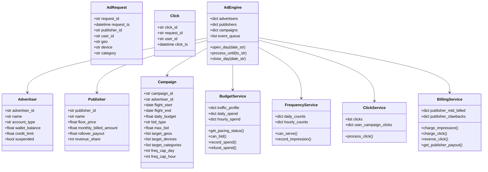
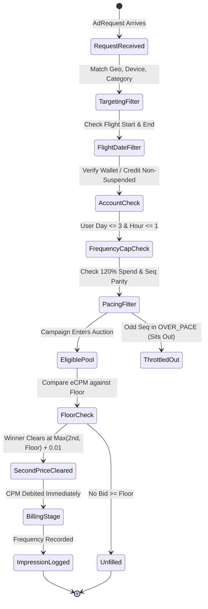
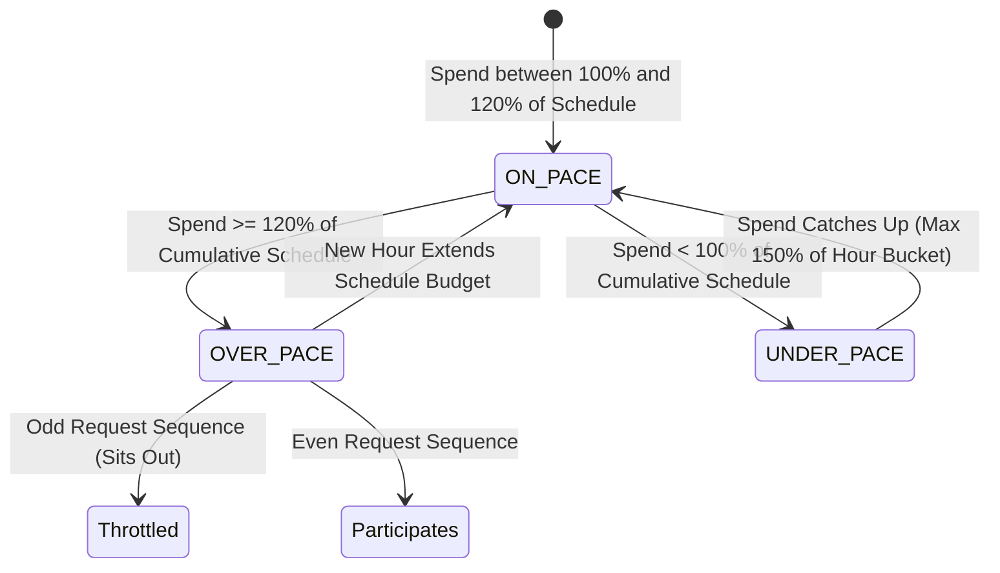
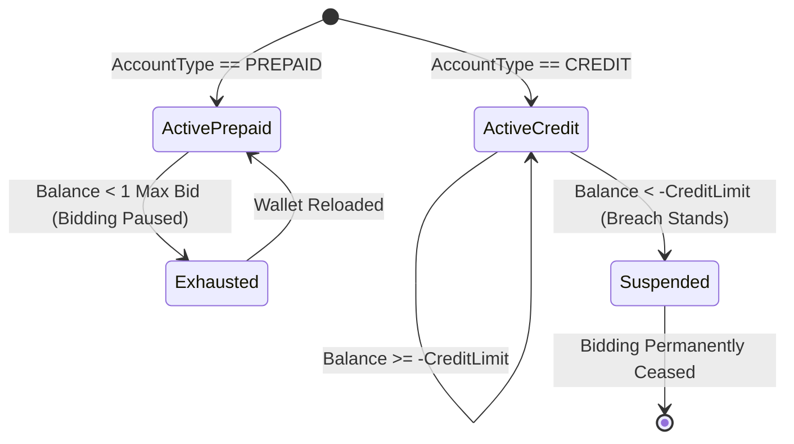

# CAPSTONE PROJECT DESIGN DOCUMENT
## PS-091: Digital Ad Auction, Budget Pacing and Frequency-Cap Engine
**Team ID**: T049  
**Team Members**: Yashwanth S ([@yashwanth06s](https://github.com/yashwanth06s)) & Yashaswini ([@yashaswini3135](https://github.com/yashaswini3135))  
**Domain**: Media - AdTech | **Language**: Python 3.10+ (Tested on Python 3.13)  
**Submission Milestone**: Week 1 Design Document (Updated for Final Review)

---

## 1. Domain Glossary

| Term | Definition & Domain Significance |
|---|---|
| **Publisher** | The digital property (website/app) supplying ad inventory slots (e.g. news portal, sports app). Sets a minimum floor price. |
| **Advertiser** | The brand purchasing ad space to promote products. Holds either a prepaid wallet or a credit facility account. |
| **Campaign** | An advertising initiative configured with flight dates, daily budget, targeting criteria, bid model, and frequency caps. |
| **CPM (Cost Per Mille)** | Cost per 1,000 ad impressions (views). CPM campaigns are billed immediately upon impression delivery. |
| **CPC (Cost Per Click)** | Pricing model where advertisers are billed only when a verified user clicks on a served ad. |
| **eCPM (Effective CPM)** | The normalized revenue per 1,000 impressions used to compare CPC and CPM bids on an equal footing: $eCPM = CPC \times CTR \times 1000$. |
| **CTR (Click-Through Rate)** | The ratio of valid clicks to impressions: $CTR = \frac{\text{Clicks}}{\text{Impressions}}$. Trailing 7-day window used for CPC normalisation. |
| **Floor Price** | The reserve CPM price set by a publisher. No ad request can clear below this price. |
| **Second-Price Auction** | Auction mechanism where the highest eligible bidder wins, but clears at $\max(\text{2nd-highest eCPM}, \text{Floor}) + \text{Rs } 0.01$. Single bidders clear at the Floor. |
| **Frequency Cap** | Rules restricting user ad fatigue: max 3 impressions per user per calendar day (IST) and max 1 per user per clock hour. |
| **Budget Pacing** | Strategy spreading daily spend across 24 hourly buckets according to an empirical traffic distribution profile. |
| **Parity Throttling** | Deterministic mechanism that forces an over-pace campaign to sit out of odd-sequence requests ($seq\_no \% 2 \ne 0$). |
| **Catch-Up Spending** | Allows an under-spent campaign to consume up to 150% of the current hour's allocated bucket. |
| **Invalid Traffic (IVT)** | Fraudulent or burst clicks: $> 5$ clicks from the same user on the same campaign within a rolling 10-minute window. |
| **Revenue Share Clawback** | Reversal of publisher credits resulting from invalidated clicks, recovered from the publisher's subsequent payout. |
| **Payout Rollover** | If a publisher's monthly payout is below Rs 5,000, disbursement is deferred and rolls over to the following month. |

---

## 2. System Architecture & Class Diagram

---

## 3. State Machine Diagrams

### 3.1 Ad Request Lifecycle & Auction Pipeline

### 3.2 Campaign Budget Pacing State Machine

### 3.3 Advertiser Account State Machine

---

## 4. Complete Business Rules Register (BR-01 to BR-12)

### BR-01: Targeting & Flight Date Eligibility
- **Condition**: Request matches `target_geos`, `target_devices`, `target_categories`. Request timestamp within `flight_start` 00:00:00 and `flight_end` 23:59:59.
- **Budget & Wallet Condition**: `spend_today < daily_budget`. Prepaid wallet $\ge 	ext{max\_bid}/1000$ (CPM) or $\ge 	ext{max\_bid}$ (CPC). Credit account non-suspended.

### BR-02: User Frequency Capping
- **Condition**: Per user ID per campaign in IST: Maximum **3 impressions/day** and **1 impression/hour**. Resets on day boundary (00:00:00) and clock hour boundaries.

### BR-03: Bid Normalisation & Trailing CTR
- **Formulas**:
  - CPM: $	ext{eCPM} = 	ext{max\_bid}$
  - CPC: $	ext{eCPM} = 	ext{max\_bid} 	imes 	ext{trailing\_ctr} 	imes 1,000$
  - Trailing CTR: Computed over prior 7 calendar days ($D-7 \le 	ext{date} < D$). Default = 0.5% (0.005) if trailing impressions $< 1,000$. At $\ge 1,000$, switches to actual CTR.

### BR-04: Second-Price Auction & Floor Clearing
- **Formulas**:
  - No bids $\ge 	ext{Floor} \implies 	ext{UNFILLED}$.
  - Single eligible bidder $\ge 	ext{Floor} \implies 	ext{Clearing CPM} = 	ext{Floor}$.
  - $\ge 2$ bidders $\implies 	ext{Clearing CPM} = \max(	ext{second-highest eCPM}, 	ext{Floor}) + 	ext{Rs } 0.01$.
  - Charge per impression: $rac{	ext{Clearing CPM}}{1000}$.

### BR-05: Auction Tie-Breaking
- **Precedence**:
  1. Lower cumulative spend today.
  2. Lower campaign ID (ascending alphanumeric sort).

### BR-06: Budget Pacing & Catch-Up Mode
- **Formulas**:
  - Cumulative scheduled budget up to current hour $H = 	ext{budget} 	imes \sum_{h=0}^H rac{	ext{pct}_h}{100}$.
  - $	ext{OVER\_PACE}$ if $	ext{spend} \ge 1.20 	imes 	ext{scheduled}$.
  - $	ext{UNDER\_PACE}$ if $	ext{spend} < 	ext{scheduled}$.
  - In catch-up mode, max hourly spend allowed $= 1.50 	imes 	ext{hour\_bucket}$.

### BR-07: Pacing Parity Throttling
- **Rule**: When `OVER_PACE`, campaign bids only on even request sequence numbers (`seq_no % 2 == 0`). Sits out on odd sequence numbers (`seq_no % 2 != 0`).

### BR-08: Billing Mechanics
- **Rules**:
  - CPM billed immediately on impression at clearing price.
  - CPC billed on click at `max_bid`, only if `spend_today < daily_budget` when click arrives.

### BR-09: Wallet & Credit Limit Management
- **Rules**:
  - Prepaid debits wallet down to 0.00.
  - Credit debits line down to `-credit_limit`. Any charge breaching limit stands and suspends the advertiser.

### BR-10: Invalid Traffic (IVT) Detection & Clawback
- **Rules**:
  - $> 5$ clicks from same user on same campaign within 10 minutes (600s) $\implies$ all clicks in window marked `INVALID`.
  - Advertiser refunded CPC charge.
  - Publisher revenue share clawed back from monthly payout.

### BR-11: Publisher Revenue Share & Payout Threshold
- **Rules**:
  - Total month-to-date billed $> 	ext{Rs } 1,00,000 \implies 70\%$ rev share.
  - $\le 	ext{Rs } 1,00,000 \implies 60\%$ rev share.
  - If payout due $< 	ext{Rs } 5,000$, rolls to next month (`payout_due = 0.00`).

### BR-12: Flight End & Budget Expiry
- **Rules**:
  - Flight serves until 23:59:59 on end date.
  - Unspent daily budget lapses at 23:59:59 and never carries forward.

---

## 5. Planted Edge Cases Verification Table

| ID | Edge Case | Observed System Output | Result |
|---|---|---|---|
| **EC-01** | Single bidder equals floor | REQ-000466: CMP-001 bids 150.00 = floor 150.00 $
ightarrow$ clears at 150.00 (Rs 0.15/imp) | Passed |
| **EC-02** | 2nd bid below floor | REQ-000171: CMP-004 (180.00) vs CMP-005 (90.00) on PUB-4 (120.00) $
ightarrow$ clears at 120.01 | Passed |
| **EC-03** | 1,000 trailing impressions | CMP-006 switches from 0.5% to 0.7% CTR on 2026-10-12 $
ightarrow$ eCPM 175.00 (REQ-000087) | Passed |
| **EC-04** | Pacing at 120.0% boundary | CMP-001 throttled on odd REQ-000519 (`ThrottledUnfilled = 1`), wins REQ-000520 at hour 1 | Passed |
| **EC-05** | Day/hour frequency boundary | REQ-000463 served (3rd today), REQ-000464 capped, REQ-000465 served at 00:00:00 next day | Passed |
| **EC-06** | 6th click within 10:00 | CLK-00057..62 on CMP-006 marked INVALID; Rs 90.00 clawed back from PUB-4 | Passed |
| **EC-07** | Publisher exactly Rs 1,00,000 | PUB-5 October total = Rs 100,000.00 $
ightarrow$ evaluated at 60% revenue share tier | Passed |
| **EC-08** | Credit breach by Rs 0.01 | ADV-07 balance hits -50,000.01 on REQ-001079 $
ightarrow$ suspended; 12 later spiritual stay unfilled | Passed |
