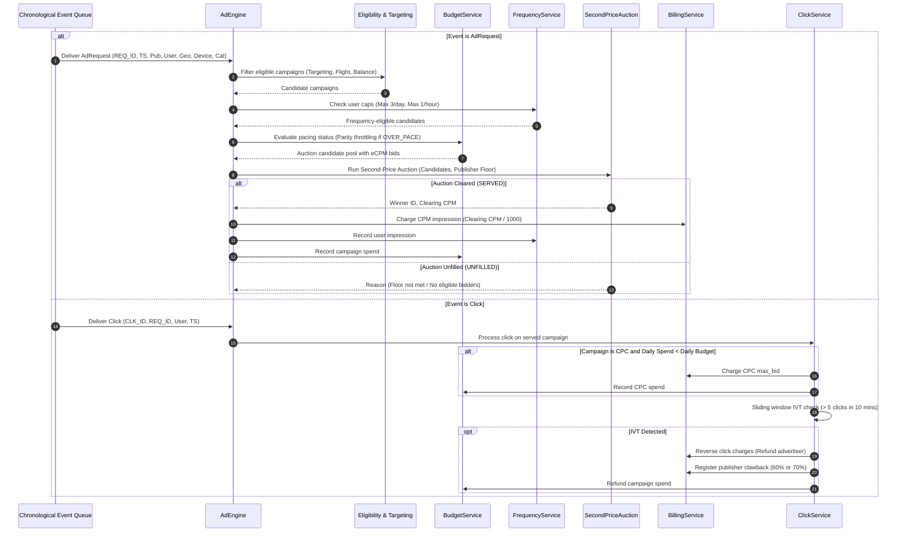
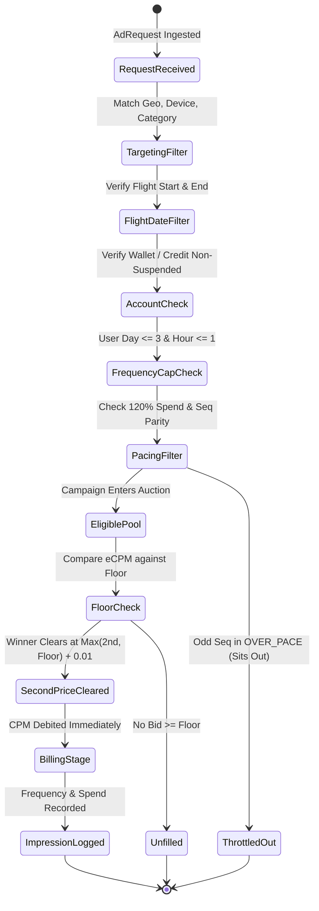
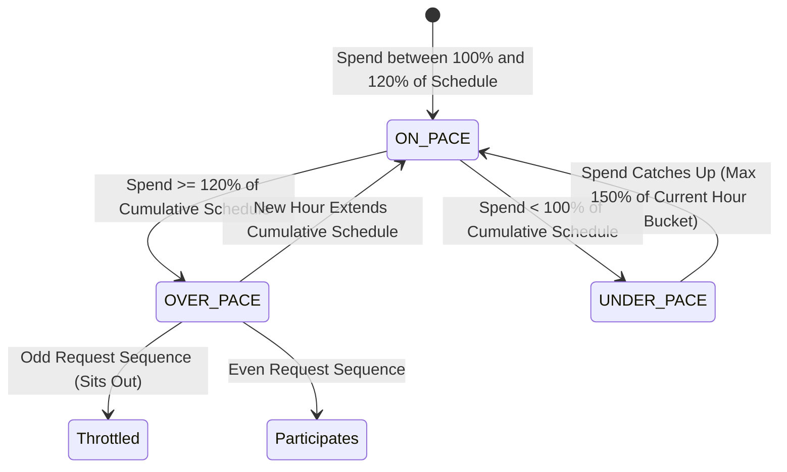
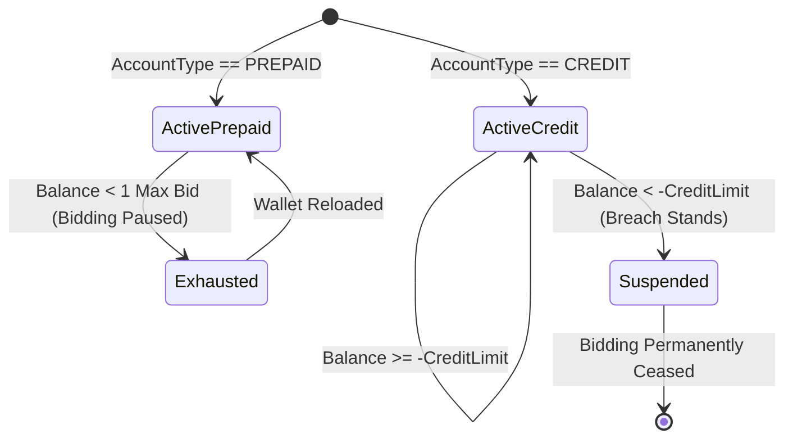

# CAPSTONE PROJECT DESIGN DOCUMENT
## PS-091: Digital Ad Auction, Budget Pacing and Frequency-Cap Engine
**Team ID**: T049  
**Domain**: Media - AdTech | **Tech Stack**: Python 3.12+  
**Team Members**: Yashwanth S ([@yashwanth06s](https://github.com/yashwanth06s)) & Yashaswini ([@yashaswini3135](https://github.com/yashaswini3135))  
**Placement Coaching Capstone Project** — 10 SECONDS  
**Submission Milestone**: Week 4 Final Submission (Updated Design Document)

---

## 1. Domain Glossary

| Term | Definition & Domain Significance |
|---|---|
| **Publisher** | The digital property (website/app) supplying ad inventory slots (e.g., news portal, OTT, sports app). Establishes a minimum reserve floor price. |
| **Advertiser** | The commercial entity purchasing ad space to promote products/services. Operates under either a prepaid wallet or credit facility. |
| **Campaign** | An advertising flight configured with start/end dates, daily budget, multi-dimensional targeting criteria, bid model, and frequency caps. |
| **CPM (Cost Per Mille)** | Cost per 1,000 ad impressions (views). CPM campaigns are billed immediately upon impression delivery. |
| **CPC (Cost Per Click)** | Performance pricing model where advertisers are billed only when a served impression receives a verified click event. |
| **eCPM (Effective CPM)** | Normalized revenue per 1,000 impressions used to compare CPC and CPM bids on an equal footing: $\text{eCPM} = \text{CPC} \times \text{CTR} \times 1000$. |
| **CTR (Click-Through Rate)** | The ratio of valid clicks to total impressions: $\text{CTR} = \frac{\text{Valid Clicks}}{\text{Impressions}}$. Trailing 7-day window is evaluated for CPC normalization. |
| **Floor Price** | The reserve CPM price configured by a publisher. No ad request can clear below this price. |
| **Second-Price Auction** | Auction mechanism where the highest eligible bidder wins, clearing at $\max(\text{2nd-highest eCPM}, \text{Floor}) + \text{Rs } 0.01$. Single eligible bidders clear at the Floor. |
| **Frequency Cap** | Fatigue prevention rule restricting ad exposure: maximum 3 impressions per user per calendar day (IST) and maximum 1 per user per clock hour. |
| **Budget Pacing** | Mechanism distributing daily campaign budget across 24 hourly buckets based on an empirical diurnal traffic distribution profile. |
| **Parity Throttling** | Deterministic throttling mechanism where an over-paced campaign ($\ge 120\%$ of schedule) participates only on even request sequence numbers ($\text{seq\_no} \pmod 2 == 0$). |
| **Catch-Up Spending** | Allows an under-spent campaign to consume up to 150% of the current hour's allocated bucket to recover lagging delivery. |
| **Invalid Traffic (IVT)** | Fraudulent or burst clicks: $> 5$ clicks from the same user on the same campaign within a rolling 10-minute window (600 seconds). |
| **Revenue Share Clawback** | Reversal of publisher revenue share credited on invalidated clicks, deducted from the publisher's monthly settlement payout. |
| **Payout Rollover** | If a publisher's monthly payout is below the minimum threshold of Rs 5,000, disbursement is deferred and rolls over to the following month. |

---

## 2. System Architecture & Class Model

```mermaid
classDiagram
    class Advertiser {
        +str advertiser_id
        +str name
        +str account_type
        +float wallet_balance
        +float credit_limit
        +bool suspended
    }

    class Publisher {
        +str publisher_id
        +str name
        +float floor_price
        +float monthly_billed_amount
        +float rollover_payout
        +int revenue_share
    }

    class Campaign {
        +str campaign_id
        +str advertiser_id
        +date flight_start
        +date flight_end
        +float daily_budget
        +str bid_type
        +float max_bid
        +list target_geos
        +list target_devices
        +list target_categories
        +int freq_cap_day
        +int freq_cap_hour
    }

    class AdRequest {
        +str request_id
        +datetime request_ts
        +str publisher_id
        +str user_id
        +str geo
        +str device
        +str category
    }

    class Click {
        +str click_id
        +str request_id
        +str user_id
        +datetime click_ts
    }

    class AdEngine {
        +dict advertisers
        +dict publishers
        +dict campaigns
        +list event_queue
        +open_day(date_str)
        +process_until(ts_str)
        +close_day(date_str)
        +export_csv_reports()
    }

    class BudgetService {
        +dict traffic_profile
        +dict daily_spend
        +dict hourly_spend
        +get_pacing_status(campaign, hour)
        +can_bid(campaign, hour, seq_no)
        +record_spend(campaign_id, hour, amount)
        +refund_spend(campaign_id, hour, amount)
    }

    class FrequencyService {
        +dict daily_counts
        +dict hourly_counts
        +can_serve(campaign, user_id, date, hour)
        +record_impression(campaign_id, user_id, date, hour)
    }

    class ClickService {
        +list clicks
        +dict user_campaign_clicks
        +process_click(click, campaign, publisher, budget_svc, billing_svc)
    }

    class BillingService {
        +dict publisher_mtd_billed
        +dict publisher_clawbacks
        +charge_impression(advertiser_id, publisher_id, clearing_cpm)
        +charge_click(advertiser_id, publisher_id, cpc_bid)
        +reverse_click(advertiser_id, publisher_id, amount)
        +get_publisher_payout(publisher_id)
    }

    AdEngine --> Advertiser
    AdEngine --> Publisher
    AdEngine --> Campaign
    AdEngine --> BudgetService
    AdEngine --> FrequencyService
    AdEngine --> ClickService
    AdEngine --> BillingService
```

---

## 3. End-to-End Processing & Event Sequence

---

## 4. State Machine Diagrams

### 4.1 Ad Request Lifecycle & Auction Pipeline

### 4.2 Campaign Budget Pacing State Machine

### 4.3 Advertiser Account State Machine

---

## 5. Comprehensive Business Rules Register (BR-01 to BR-12)

### BR-01: Eligibility & Targeting
- **Condition**: An ad campaign is eligible to bid for an incoming request if and only if:
  1. The request matches all targeting dimensions: `target_geos`, `target_devices`, and `target_categories` (supports lists and wildcards `ALL`, `*`, `ANY`).
  2. Request timestamp is within `flight_start` 00:00:00 and `flight_end` 23:59:59 IST.
  3. Campaign daily spend has not exhausted daily budget (`spend_today < daily_budget`).
  4. Advertiser account is solvent:
     - `PREPAID`: `wallet_balance >= max_bid / 1000` (CPM) or `wallet_balance >= max_bid` (CPC).
     - `CREDIT`: Account is not `SUSPENDED`.

### BR-02: Frequency Capping
- **Condition**: Maximum **3 impressions** per user per calendar day (IST) and maximum **1 impression** per user per clock hour (IST) for a given campaign.
- **Resets**: Daily caps reset at 00:00:00 IST; hourly caps reset on clock hour transitions.

### BR-03: Bid Normalisation (Effective CPM / eCPM)
- **Formulas**:
  - **CPM Campaigns**: $\text{eCPM} = \text{max\_bid}$
  - **CPC Campaigns**: $\text{eCPM} = \text{max\_bid} \times \text{trailing\_ctr} \times 1,000$
  - **Trailing CTR Calculation**:
    - Evaluated across prior 7 calendar days ($D-7 \le \text{date} < D$).
    - If total trailing impressions $< 1,000$, use default $\text{CTR} = 0.5\%$ ($0.005$).
    - At $\ge 1,000$ trailing impressions, switch immediately to actual historical CTR:
      $$\text{CTR} = \frac{\text{valid\_clicks}}{\text{impressions}}$$

### BR-04: Second-Price Auction & Floor Clearing
- **Formulas**:
  - If no eligible candidate meets or exceeds the publisher floor: Result is `UNFILLED`.
  - Exactly **1 eligible candidate** $\ge \text{Floor}$: Clears at $\text{Clearing CPM} = \text{Floor}$.
  - **$\ge 2$ eligible candidates** participate:
    $$\text{Clearing CPM} = \max(\text{second-highest eCPM}, \text{Floor}) + \text{Rs } 0.01$$
  - Price per impression: $\frac{\text{Clearing CPM}}{1000}$.

### BR-05: Auction Tie-Breaking
- **Precedence**:
  1. Campaign with lower cumulative spend today wins.
  2. If still tied, campaign with alphabetically lower campaign ID wins (ascending sort).

### BR-06: Budget Pacing
- **Formulas**:
  - Cumulative scheduled budget through hour $H$:
    $$\text{Scheduled Budget} = \text{daily\_budget} \times \frac{\sum_{h=0}^H \text{pct}_h}{100}$$
  - $\text{OVER\_PACE}$: $\text{spend\_today} \ge 1.20 \times \text{Scheduled Budget}$.
  - $\text{UNDER\_PACE}$: $\text{spend\_today} < \text{Scheduled Budget}$.
  - Catch-up limit: In $\text{UNDER\_PACE}$, allowable spend in current hour is capped at $150\%$ of the current hour's allocated bucket.

### BR-07: Pacing Parity Throttling
- **Rule**: When $\text{OVER\_PACE}$, campaign bids only on even request sequence numbers:
  $$\text{seq\_no} \pmod 2 == 0 \implies \text{Eligible to bid}$$
  $$\text{seq\_no} \pmod 2 \ne 0 \implies \text{Sits out (Throttled)}$$

### BR-08: Billing Mechanics
- **Rules**:
  - CPM billed immediately on impression delivery at $\frac{\text{Clearing CPM}}{1000}$.
  - CPC billed on click at `max_bid`, only if `spend_today < daily_budget` when the click arrives.

### BR-09: Wallet & Credit Limit Management
- **Rules**:
  - Prepaid debits wallet balance down to 0.00.
  - Credit debits line down to `-credit_limit`. Any charge breaching `-credit_limit` stands, and the advertiser is immediately marked `SUSPENDED`.

### BR-10: Invalid Traffic (IVT) Detection & Clawback
- **Rules**:
  - A rolling 10-minute sliding window (600s) monitors clicks per $(user\_id, campaign\_id)$.
  - If $> 5$ clicks arrive within 10 minutes:
    1. All burst clicks in the window are marked `INVALID`.
    2. Advertiser billing for these clicks is reversed (refunded to wallet/credit balance).
    3. The credited publisher revenue share is clawed back from the publisher's monthly payout.

### BR-11: Publisher Revenue Share & Payout Threshold
- **Rules**:
  - If month-to-date billed $> \text{Rs } 1,00,000$: Revenue share is **70%**.
  - If month-to-date billed $\le \text{Rs } 1,00,000$: Revenue share is **60%**.
  - Net Payout $= \text{Share Amount} + \text{Rollover In} - \text{Clawback}$.
  - If Net Payout $< \text{Rs } 5,000$: Payout is deferred and rolled to next month (`payout_due = 0.00`).

### BR-12: Flight End & Budget Expiry
- **Rules**:
  - Campaigns serve until 23:59:59 on `flight_end`.
  - Unspent daily budget or campaign budget lapses and **never carries forward**.

---

## 6. Planted Edge Cases Verification (EC-01 to EC-08)

| Code | Planted Scenario | Engine Verification & Output Evidence | Status |
|---|---|---|---|
| **EC-01** | Single bidder equals floor | `REQ-000466`: CMP-001 bids 150.00 = floor 150.00 $\to$ pays 150.00 CPM (Rs 0.15/imp) | **VERIFIED** |
| **EC-02** | 2nd bid below floor | `REQ-000171`: CMP-004 (180.00) vs CMP-005 (90.00) on PUB-4 (120.00) $\to$ clears at 120.01 | **VERIFIED** |
| **EC-03** | 1,000 trailing impressions | CMP-006 switches from 0.5% default to 0.7% actual CTR on 2026-10-12 $\to$ eCPM 175.00 (`REQ-000087`) | **VERIFIED** |
| **EC-04** | 120.0% pacing boundary | CMP-001 throttled on odd `REQ-000519` (`ThrottledUnfilled = 1`), wins `REQ-000520` at hour 1 | **VERIFIED** |
| **EC-05** | Day/hour frequency boundary | `REQ-000463` served (3rd today), `REQ-000464` capped, `REQ-000465` served at 00:00:00 next day | **VERIFIED** |
| **EC-06** | 6th click within 10:00 | `CLK-00057..62` on CMP-006 marked INVALID; Rs 90.00 clawed back from PUB-4 | **VERIFIED** |
| **EC-07** | Publisher at exactly Rs 1,00,000 | PUB-5 October total reaches exactly Rs 1,00,000.00 $\to$ evaluated at 60% revenue share tier | **VERIFIED** |
| **EC-08** | Credit breach by Rs 0.01 | ADV-07 balance hits -50,000.01 on `REQ-001079` $\to$ charge stands, suspended; 12 subsequent requests stay unfilled | **VERIFIED** |
